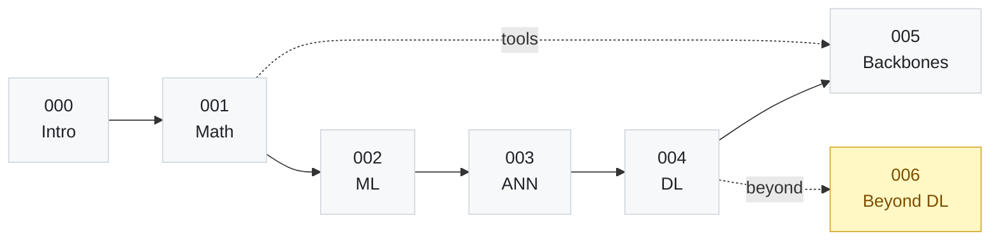

<div align="center">

# AI Foundations Handbook

**From linear algebra to knowledge graphs: 37 Chinese-language AI notes, verifiable line by line**


[](LICENSE)

[中文](README.md) | [English](README-English.md)

[Content Map](#content-map) · [Reading Paths](#reading-paths) · [Notes Index](#notes-index) · [Typography Conventions](#typography-conventions)

</div>

---

## A phenomenon to start with

> 98% on the training set, 92% on validation, 70% after a week in production.

Problems like this rarely yield to more tuning. Trace them back and the cause is usually not one wrong line of code but three gaps opening at once: where generalization error comes from, why gradients disappear, and which data violates a model's assumptions.

These notes are ordered to close those gaps: every conclusion is derived from its premises, every symbol is defined, and every method is described together with the conditions under which it holds and the data on which it breaks down.

- **Verifiable formulas** — 258 block-level formulas, each checked term by term for variable meaning and derivation;
- **Traceable terminology** — every term carries its English full name and abbreviation at first use, then a glossary table at the end;
- **Consistent structure** — all 37 notes share one template, so you always know where to look for the conclusion;
- **Engineering-minded** — each method includes its limitations and failure modes, not just why it works.

> Roughly 281,000 characters and 9,083 lines of Markdown, plus 113 "beginner tip" blocks dedicated to the terms and formulas that trip people up most.

## Content Map

The thirty-second version: `001`–`006` supply the mathematical tools, `007`–`015` the algorithm paradigms, `016`–`032` take apart network structures and training methods, and `033`–`036` look beyond deep learning.



- **`000` Introduction** · 1 note · technical routes, knowledge map — place every topic on a global map.
- **`001` Mathematical Foundations** · 6 notes · linear algebra, probability, statistics, optimization, information theory, formal logic — read every formula in the later sections.
- **`002` Machine Learning** · 9 notes · overview, regression, naive Bayes, logistic regression, decision trees, SVM, ensembles, clustering, dimensionality reduction — derive classical losses and update rules by hand.
- **`003` Artificial Neural Networks** · 6 notes · biological background, perceptrons, MLPs, RBF networks, SOMs, fuzzy networks — see how network structures evolved step by step.
- **`004` Deep Learning** · 6 notes · overview, feedforward networks, regularization, optimization, autoencoders, deep RL — train and tune a deep model yourself.
- **`005` Neural Networks under Frameworks** · 5 notes · DBN, CNN, RNN, GAN, LSTM — understand the motivation and structure of mainstream backbones.
- **`006` AI Beyond Deep Learning** · 4 notes · graphical models, swarm intelligence, transfer learning, knowledge graphs — step outside deep learning and see the other route.

## Reading Paths

### Path 1 — One-week overview

If time is short, these five notes form a minimal complete chain:

`000 Introduction` → `007 ML Overview` → `018 Multilayer Perceptron` → `023 Deep Feedforward Networks` → `029 Convolutional Networks`

Start from "what routes AI has taken", build up the notions of generalization and evaluation, see how backpropagation trains a network, and finish on a concrete architecture.

### Path 2 — Full run

Read all 37 notes in numerical order. Notes within a section depend on each other; when jumping across sections, go back and fill in the corresponding mathematics first:

1. `000` → `001`–`006`: tools before algorithms;
2. `007`–`015`: classical machine learning, focused on losses and regularization;
3. `016`–`021`: the evolution of network structures — watch for the biological or geometric intuition behind each rule;
4. `022`–`027`: training techniques, best read against optimization and information theory in 001–006;
5. `028`–`032`: mainstream backbones — keep the original papers at hand;
6. `033`–`036`: non-deep-learning routes, useful for understanding the limits of deep learning.

### Path 3 — Lookup

| Looking for | Go to |
| --- | --- |
| Overfitting, bias and variance | `007`, `024` |
| Vanishing and exploding gradients | `025`, `030`, `032` |
| Attention mechanisms | `032` |
| Generative models | `026`, `031` |
| Receptive fields and parameter sharing | `029` |
| Graphical models and approximate inference | `033` |
| Pre-training, fine-tuning and negative transfer | `035` |
| Knowledge representation and reasoning | `006`, `036` |

## Notes Index

Grouped by section. Click a section title to expand its table of contents.

<details>
<summary><b>000 开篇 (Introduction)</b> · 1 note</summary>

| No. | Note | Topics |
| --- | --- | --- |
| 000 | [Introduction to AI: from hype to technical routes](notes/000-开篇/000-人工智能导论：从热潮到技术路线.md) | Technical routes, knowledge map |

</details>

<details>
<summary><b>001 数学基础 (Mathematical Foundations)</b> · 6 notes</summary>

| No. | Note | Topics |
| --- | --- | --- |
| 001 | [Linear Algebra: vectors, matrices, and eigen-decomposition](notes/001-数学基础/001-线性代数：向量、矩阵与特征分解.md) | Norms, inner product, EVD, SVD |
| 002 | [Probability: uncertainty, Bayes, and common distributions](notes/001-数学基础/002-概率论：不确定性、贝叶斯与常见分布.md) | Conditional probability, Bayes, distributions |
| 003 | [Mathematical Statistics: estimation and hypothesis testing](notes/001-数学基础/003-数理统计：参数估计与假设检验.md) | Point estimation, confidence intervals, bias-variance |
| 004 | [Optimization: gradient descent, Newton's method, and heuristics](notes/001-数学基础/004-最优化：梯度下降、牛顿法与启发式算法.md) | Lagrange multipliers, SGD, trust region |
| 005 | [Information Theory: entropy, mutual information, and maximum entropy](notes/001-数学基础/005-信息论：熵、互信息与最大熵.md) | Entropy, KL divergence, MaxEnt |
| 006 | [Formal Logic: predicate logic, production systems, and incompleteness](notes/001-数学基础/006-形式逻辑：谓词逻辑、产生式系统与不完备性.md) | Knowledge representation, inference, Gödel |

</details>

<details>
<summary><b>002 机器学习 (Machine Learning)</b> · 9 notes</summary>

| No. | Note | Topics |
| --- | --- | --- |
| 007 | [Machine learning overview: hypothesis space, generalization error and model evaluation](notes/002-机器学习/007-机器学习概论：假设空间、泛化误差与模型评估.md) | Overfitting, cross validation, generative vs discriminative |
| 008 | [Linear regression: least squares, regularization and GLM](notes/002-机器学习/008-线性回归：最小二乘、正则化与广义线性模型.md) | Maximum likelihood, ridge, LASSO, basis functions |
| 009 | [Naive Bayes: Bayes decision, conditional independence and smoothing](notes/002-机器学习/009-朴素贝叶斯：贝叶斯决策、条件独立与平滑.md) | Priors and posteriors, MLE, text classification |
| 010 | [Logistic regression: log-odds, maximum likelihood and Softmax](notes/002-机器学习/010-逻辑回归：对数几率、最大似然与%20Softmax.md) | Sigmoid, gradient descent, multiclass extension |
| 011 | [Decision trees: information gain, Gini index and pruning](notes/002-机器学习/011-决策树：信息增益、基尼系数与剪枝.md) | ID3, C4.5, CART, pre-pruning and post-pruning |
| 012 | [Support vector machines: margin maximization, kernel trick and SMO](notes/002-机器学习/012-支持向量机：间隔最大化、核技巧与%20SMO.md) | Hard margin, soft margin, dual problem, support vectors |
| 013 | [Ensemble learning: Boosting, Bagging and random forests](notes/002-机器学习/013-集成学习：Boosting、Bagging%20与随机森林.md) | AdaBoost, bootstrap sampling, bias and variance |
| 014 | [Clustering: distance measures, k-means and DBSCAN](notes/002-机器学习/014-聚类分析：距离度量、k%20均值与%20DBSCAN.md) | Hierarchical clustering, EM, density-reachability |
| 015 | [Dimensionality reduction: PCA, kernel PCA and feature selection](notes/002-机器学习/015-降维学习：主成分分析、核化%20PCA%20与特征选择.md) | Covariance matrix, eigendecomposition, wrapper and filter methods |

</details>

<details>
<summary><b>003 人工神经网络 (Artificial Neural Networks)</b> · 6 notes</summary>

| No. | Note | Topics |
| --- | --- | --- |
| 016 | [Physiological background of neural networks: neurons, cognitive hierarchy and the limits of silicon](notes/003-人工神经网络/016-神经网络的生理学背景：神经元、认知层级与硅基局限.md) | Connectionism, perceptual objects, synchronous oscillation, memory wall |
| 017 | [Neurons and perceptrons: the MP model, Hebbian learning and the XOR dilemma](notes/003-人工神经网络/017-神经元与感知器：MP%20模型、赫布学习与异或困境.md) | Threshold logic unit, Hebbian rule, linear separability and convergence |
| 018 | [Multilayer perceptrons: hidden layers, backpropagation and gradient descent](notes/003-人工神经网络/018-多层感知器：隐藏层、反向传播与梯度下降.md) | Squared error, chain rule, local gradient, universal approximation |
| 019 | [Radial basis function networks: local approximation, receptive fields and k-means training](notes/003-人工神经网络/019-径向基函数网络：局部逼近、感受野与%20K%20均值训练.md) | Gaussian function, interpolation, recursive least squares |
| 020 | [Self-organizing maps: competitive learning, lateral inhibition and topological ordering](notes/003-人工神经网络/020-自组织特征映射：竞争学习、侧向抑制与拓扑排序.md) | Winner-takes-all, neighborhood function, vector quantization, U-matrix |
| 021 | [Fuzzy neural networks: fuzzy sets, level sets and genetic algorithms](notes/003-人工神经网络/021-模糊神经网络：模糊集合、水平集与遗传算法.md) | Membership degree, extension principle, cutoff point, conjugate gradient |

</details>

<details>
<summary><b>004 深度学习 (Deep Learning)</b> · 6 notes</summary>

| No. | Note | Topics |
| --- | --- | --- |
| 022 | [Deep learning overview: Deep Blue vs. AlphaGo, hierarchical abstraction and engineering conditions](notes/004-深度学习/022-深度学习概述：深蓝与%20AlphaGo、层级抽象与工程条件.md) | Deep Blue and AlphaGo, hierarchical features, data and compute |
| 023 | [Deep feedforward networks: universal approximation, loss functions and activation functions](notes/004-深度学习/023-深度前馈网络：通用逼近、损失函数与激活函数.md) | Universal approximation theorem, cross-entropy, ReLU |
| 024 | [Regularization: data augmentation, weight sharing and weight decay](notes/004-深度学习/024-正则化：数据增强、参数共享与权重衰减.md) | Data augmentation, Dropout, L1/L2, early stopping |
| 025 | [Optimization: ill-conditioned Hessian, SGD and momentum](notes/004-深度学习/025-优化：病态%20Hessian、随机梯度下降与动量法.md) | Condition number, saddle points, variance reduction, momentum |
| 026 | [Autoencoders: undercomplete coding, stacked pre-training and variational generation](notes/004-深度学习/026-自编码器：欠完备编码、栈式预训练与变分生成.md) | Bottleneck representation, stacked pre-training, denoising, VAE |
| 027 | [Deep reinforcement learning: Markov decision processes, DQN and policy gradients](notes/004-深度学习/027-深度强化学习：马尔可夫决策、深度%20Q%20网络与策略梯度.md) | MDP, DQN, policy gradient, model-based methods |

</details>

<details>
<summary><b>005 深度学习框架下的神经网络 (Neural Networks under Frameworks)</b> · 5 notes</summary>

| No. | Note | Topics |
| --- | --- | --- |
| 028 | [Deep belief networks: restricted Boltzmann machines, contrastive divergence and layer-wise pre-training](notes/005-深度学习框架下的神经网络/028-深度信念网络：受限玻尔兹曼机、对比散度与逐层预训练.md) | RBM, contrastive divergence, layer-wise pre-training |
| 029 | [Convolutional neural networks: convolution, sparse interaction and feature maps](notes/005-深度学习框架下的神经网络/029-卷积神经网络：卷积运算、稀疏感知与特征映射.md) | Kernels, parameter sharing, pooling, residual networks |
| 030 | [Recurrent neural networks: temporal weight sharing, bidirectional structure and recursive networks](notes/005-深度学习框架下的神经网络/030-循环神经网络：时序参数共享、双向结构与递归网络.md) | BPTT, bidirectional RNN, recursive networks |
| 031 | [Generative adversarial networks: zero-sum games, minimax and training difficulties](notes/005-深度学习框架下的神经网络/031-生成式对抗网络：零和博弈、极小极大与训练难题.md) | Generator, discriminator, JS divergence, mode collapse |
| 032 | [Long short-term memory: gating, memory cells and gradient vanishing](notes/005-深度学习框架下的神经网络/032-长短期记忆网络：门控机制、记忆单元与梯度弥散.md) | Forget gate, input gate, output gate, peephole connections |

</details>

<details>
<summary><b>006 深度学习之外的人工智能 (AI Beyond Deep Learning)</b> · 4 notes</summary>

| No. | Note | Topics |
| --- | --- | --- |
| 033 | [Probabilistic graphical models: Bayesian networks, Markov random fields and conditional independence](notes/006-深度学习之外的人工智能/033-概率图模型：贝叶斯网络、马尔可夫随机场与条件独立性.md) | DAG, conditional independence, potential functions, partition function |
| 034 | [Swarm intelligence: self-organization, decentralization and emergence](notes/006-深度学习之外的人工智能/034-集群智能：自组织、分布式与涌现.md) | Self-organization, emergence, ant colony optimization, pheromone |
| 035 | [Transfer learning: source and target domains, four method families and meta-learning](notes/006-深度学习之外的人工智能/035-迁移学习：源域目标域、四类迁移方法与元学习.md) | Source and target domains, negative transfer, pre-training and fine-tuning, meta-learning |
| 036 | [Knowledge graphs: inference, soft logic and distributed representation](notes/006-深度学习之外的人工智能/036-知识图谱：知识推理、软性逻辑与分布式表示.md) | Triple, path ranking, Markov logic network, TransE |

</details>

## Anatomy of a Note

All 37 notes share one template: learn it once and you have learned them all.

| Part | Purpose |
| --- | --- |
| H1 title | "Topic: subtitle", identical to the file name with the number prefix removed |
| Sections | Major sections numbered 一、二、三, subsections 1.1, 1.2 — headings state conclusions, not labels |
| **补充说明** (supplementary note) | Expands the error-prone points: extra derivation, concept comparison, engineering trade-offs |
| 新手提示 (beginner tip) | Blockquote explaining the terms and formulas most likely to block a newcomer |
| 要点回顾 (key points) | Numbered list, usually 10–12 items, usable as a revision checklist |
| 名词汇总 (glossary) | Table of term / full English name / abbreviation / brief description |

## Typography Conventions

These conventions keep the notes readable on GitHub, in a terminal, and in a local editor alike.

- No inline math: symbols such as α, σ, ∇, ⊙ are written as Unicode characters and stay legible without a renderer;
- Block-level formulas only where the derivation requires them, rendered natively by GitHub — no plugin needed;
- Chinese text uses curly quotes; terms carry their English full name and abbreviation at first use, then Chinese or the abbreviation only;
- All files are UTF-8 without BOM and open cleanly on Windows, macOS and Linux.

## Repository Layout

```text
ai-foundations-handbook/
├── README.md                        # Chinese documentation
├── README-English.md                # English version (this file)
├── LICENSE                          # MIT
├── docs/                            # Reserved for slides and PDF material, not distributed
└── notes/
    ├── 000-开篇/                     # 1 note  · technical routes
    ├── 001-数学基础/                 # 6 notes · linear algebra, probability, statistics, optimization, information theory, logic
    ├── 002-机器学习/                 # 9 notes · from overview to dimensionality reduction
    ├── 003-人工神经网络/             # 6 notes · neurons, perceptrons and network structures
    ├── 004-深度学习/                 # 6 notes · deep networks and training techniques
    ├── 005-深度学习框架下的神经网络/ # 5 notes · deep belief networks, convolution, recurrence and memory
    └── 006-深度学习之外的人工智能/   # 4 notes · graphical models, swarm intelligence, transfer learning, knowledge graphs
```

File names follow `007-机器学习概论：假设空间、泛化误差与模型评估.md`, with the topic before the colon and the subtitle after it. Links containing spaces are encoded as `%20` in Markdown.

## Reading Locally

```bash
git clone https://github.com/Ashleycurry/ai-foundations-handbook.git
cd ai-foundations-handbook
```

- **Online**: open any note directly on GitHub; formulas are rendered natively;
- **VS Code**: install Markdown Preview Enhanced or Markdown All in One for LaTeX preview and outline navigation;
- **Obsidian / Typora**: open `notes/` as the vault root and browse by section.

## Contributing & Feedback

- Found a wrong formula, a mistaken conclusion or an unclear passage? Open an issue with the file name and section number;
- Better translations of terms or better symbol conventions are welcome in the issue tracker;
- When quoting or reposting, please cite the source and comply with the MIT license.

## License

This project is licensed under the [MIT License](LICENSE).

<div align="center">

If these notes help you, a star is appreciated — and issues pointing out mistakes are even more so.

[Back to top](#ai-foundations-handbook)

</div>
