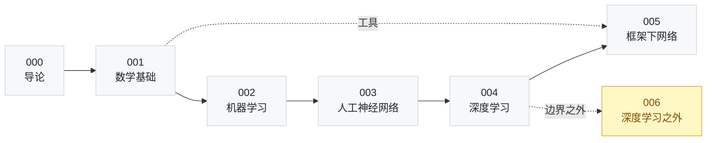

<div align="center">

# AI 基础手册

**从线性代数到知识图谱，37 篇可逐行验算的中文 AI 笔记**


[](LICENSE)

[中文](README.md) | [English](README-English.md)

[内容地图](#内容地图) · [学习路线](#学习路线) · [笔记索引](#笔记索引) · [排版约定](#排版约定)

</div>

---

## 从一个现象说起

> 训练集准确率 98%，验证集 92%，上线一周后掉到 70%。

这类问题几乎无法靠继续调参解决。往回追，原因往往不在某一行代码，而在三处同时空着：不清楚泛化误差从哪里来，不知道梯度为什么会消失，也说不准模型的假设在什么数据上不成立。

这套笔记按“把空补上”的顺序整理：每个结论都从前提推起，每个符号都给出定义，每个方法都交代它在什么条件下成立、在什么数据上会失效。

- **公式可验算** —— 258 个块级公式，逐项核对过变量含义与推导步骤；
- **术语有出处** —— 名词首次出现时给出英文全称与缩写，篇末汇总成表；
- **体例统一** —— 37 篇共用一套结构，翻到任何一篇都知道去哪里找结论；
- **面向工程** —— 每个方法都写了局限与失效场景，不只讲它为什么有效。

> 全库约 30 万字、9,613 行 Markdown，另有 113 条“新手提示”，专门解释最容易卡住的术语与公式。

## 内容地图

三十秒版本：`001`–`006` 给数学工具，`007`–`015` 给算法范式，`016`–`032` 拆网络结构与训练方法，`033`–`036` 看深度学习之外的路线。



- **`000` 开篇** · 1 篇 · 技术路线、知识地图 —— 建立全局坐标系，知道每块知识的位置。
- **`001` 数学基础** · 6 篇 · 线性代数、概率论、数理统计、最优化、信息论、形式逻辑 —— 看懂后续所有章节里的公式。
- **`002` 机器学习** · 9 篇 · 概论、回归、朴素贝叶斯、逻辑回归、决策树、SVM、集成、聚类、降维 —— 手推经典算法的损失函数与更新式。
- **`003` 人工神经网络** · 6 篇 · 生理背景、感知器、多层感知器、RBF、SOM、模糊网络 —— 理解网络结构如何一步步演化。
- **`004` 深度学习** · 6 篇 · 概述、前馈网络、正则化、优化、自编码器、深度强化学习 —— 独立训练并调优一个深度模型。
- **`005` 框架下的神经网络** · 5 篇 · 深度信念网络、卷积、循环、对抗生成、长短期记忆 —— 掌握主流骨架的动机与结构。
- **`006` 深度学习之外** · 4 篇 · 概率图模型、集群智能、迁移学习、知识图谱 —— 跳出深度学习，看清另一条技术路线。

## 学习路线

### 路线一 · 一周速览

时间有限时，按这条线读五篇，能串起一条最小完整链条：

`000 导论` → `007 机器学习概论` → `018 多层感知器` → `023 深度前馈网络` → `029 卷积神经网络`

从“AI 有哪些路线”出发，先建立评估与泛化概念，再看反向传播如何训练网络，最后落到一个具体结构上。

### 路线二 · 完整通关

按编号顺序读完全部 37 篇。每个板块内部的篇目是有依赖的，跨板块跳跃时建议至少回头补上对应的数学篇目：

1. `000` → `001`～`006`：先有工具，再看算法；
2. `007`～`015`：经典机器学习，重点在损失函数与正则化；
3. `016`～`021`：网络结构演化，注意每条规则背后的生理或几何直觉；
4. `022`～`027`：训练技巧，与 001～006 的优化、信息论内容对照阅读；
5. `028`～`032`：主流网络骨架，建议配合论文原文；
6. `033`～`036`：非深度学习路线，用于理解深度学习的能力边界。

### 路线三 · 专题直达

| 想查什么 | 去哪里 |
| --- | --- |
| 过拟合、偏差与方差 | `007`、`024` |
| 梯度消失与梯度爆炸 | `025`、`030`、`032` |
| 注意力机制 | `032` |
| 生成模型 | `026`、`031` |
| 卷积的感受野与参数共享 | `029` |
| 概率图模型与近似推断 | `033` |
| 预训练、微调与负迁移 | `035` |
| 知识表示与推理 | `006`、`036` |

## 笔记索引

按板块归档。点击标题展开该板块的完整目录。

<details>
<summary><b>000 开篇</b> · 1 篇</summary>

| 编号 | 笔记 | 主题 |
| --- | --- | --- |
| 000 | [人工智能导论：从热潮到技术路线](notes/000-开篇/000-人工智能导论：从热潮到技术路线.md) | 技术路线、知识地图 |

</details>

<details>
<summary><b>001 数学基础</b> · 6 篇</summary>

| 编号 | 笔记 | 主题 |
| --- | --- | --- |
| 001 | [线性代数：向量、矩阵与特征分解](notes/001-数学基础/001-线性代数：向量、矩阵与特征分解.md) | 范数、内积、特征值分解、SVD |
| 002 | [概率论：不确定性、贝叶斯与常见分布](notes/001-数学基础/002-概率论：不确定性、贝叶斯与常见分布.md) | 条件概率、贝叶斯、常见分布 |
| 003 | [数理统计：参数估计与假设检验](notes/001-数学基础/003-数理统计：参数估计与假设检验.md) | 点估计、置信区间、偏差方差 |
| 004 | [最优化：梯度下降、牛顿法与启发式算法](notes/001-数学基础/004-最优化：梯度下降、牛顿法与启发式算法.md) | 拉格朗日乘子、SGD、置信域 |
| 005 | [信息论：熵、互信息与最大熵](notes/001-数学基础/005-信息论：熵、互信息与最大熵.md) | 熵、KL 散度、最大熵模型 |
| 006 | [形式逻辑：谓词逻辑、产生式系统与不完备性](notes/001-数学基础/006-形式逻辑：谓词逻辑、产生式系统与不完备性.md) | 知识表示、自动推理、哥德尔定理 |

</details>

<details>
<summary><b>002 机器学习</b> · 9 篇</summary>

| 编号 | 笔记 | 主题 |
| --- | --- | --- |
| 007 | [机器学习概论：假设空间、泛化误差与模型评估](notes/002-机器学习/007-机器学习概论：假设空间、泛化误差与模型评估.md) | 过拟合、交叉验证、生成式与判别式 |
| 008 | [线性回归：最小二乘、正则化与广义线性模型](notes/002-机器学习/008-线性回归：最小二乘、正则化与广义线性模型.md) | 极大似然、岭回归、LASSO、基函数 |
| 009 | [朴素贝叶斯：贝叶斯决策、条件独立与平滑](notes/002-机器学习/009-朴素贝叶斯：贝叶斯决策、条件独立与平滑.md) | 先验与后验、极大似然估计、文本分类 |
| 010 | [逻辑回归：对数几率、最大似然与 Softmax](notes/002-机器学习/010-逻辑回归：对数几率、最大似然与%20Softmax.md) | Sigmoid、梯度下降、多分类推广 |
| 011 | [决策树：信息增益、基尼系数与剪枝](notes/002-机器学习/011-决策树：信息增益、基尼系数与剪枝.md) | ID3、C4.5、CART、预剪枝与后剪枝 |
| 012 | [支持向量机：间隔最大化、核技巧与 SMO](notes/002-机器学习/012-支持向量机：间隔最大化、核技巧与%20SMO.md) | 硬间隔、软间隔、对偶问题、支持向量 |
| 013 | [集成学习：Boosting、Bagging 与随机森林](notes/002-机器学习/013-集成学习：Boosting、Bagging%20与随机森林.md) | AdaBoost、自助采样、偏差与方差 |
| 014 | [聚类分析：距离度量、k 均值与 DBSCAN](notes/002-机器学习/014-聚类分析：距离度量、k%20均值与%20DBSCAN.md) | 层次聚类、EM 算法、密度可达 |
| 015 | [降维学习：主成分分析、核化 PCA 与特征选择](notes/002-机器学习/015-降维学习：主成分分析、核化%20PCA%20与特征选择.md) | 协方差矩阵、特征值分解、包裹法与过滤法 |

</details>

<details>
<summary><b>003 人工神经网络</b> · 6 篇</summary>

| 编号 | 笔记 | 主题 |
| --- | --- | --- |
| 016 | [神经网络的生理学背景：神经元、认知层级与硅基局限](notes/003-人工神经网络/016-神经网络的生理学背景：神经元、认知层级与硅基局限.md) | 连接主义、知觉物体、同步震荡、内存墙 |
| 017 | [神经元与感知器：MP 模型、赫布学习与异或困境](notes/003-人工神经网络/017-神经元与感知器：MP%20模型、赫布学习与异或困境.md) | 阈值逻辑单元、赫布规则、线性可分与收敛 |
| 018 | [多层感知器：隐藏层、反向传播与梯度下降](notes/003-人工神经网络/018-多层感知器：隐藏层、反向传播与梯度下降.md) | 平方误差、链式法则、局域梯度、万能逼近 |
| 019 | [径向基函数网络：局部逼近、感受野与 K 均值训练](notes/003-人工神经网络/019-径向基函数网络：局部逼近、感受野与%20K%20均值训练.md) | 高斯函数、感受野、插值、递归最小二乘 |
| 020 | [自组织特征映射：竞争学习、侧向抑制与拓扑排序](notes/003-人工神经网络/020-自组织特征映射：竞争学习、侧向抑制与拓扑排序.md) | 胜者通吃、拓扑邻域、向量量化、U 矩阵 |
| 021 | [模糊神经网络：模糊集合、水平集与遗传算法](notes/003-人工神经网络/021-模糊神经网络：模糊集合、水平集与遗传算法.md) | 隶属度、扩展原理、截断点、共轭梯度 |

</details>

<details>
<summary><b>004 深度学习</b> · 6 篇</summary>

| 编号 | 笔记 | 主题 |
| --- | --- | --- |
| 022 | [深度学习概述：深蓝与 AlphaGo、层级抽象与工程条件](notes/004-深度学习/022-深度学习概述：深蓝与%20AlphaGo、层级抽象与工程条件.md) | 深蓝与 AlphaGo、层级抽象、数据与算力 |
| 023 | [深度前馈网络：通用逼近、损失函数与激活函数](notes/004-深度学习/023-深度前馈网络：通用逼近、损失函数与激活函数.md) | 通用逼近定理、交叉熵、整流线性单元 |
| 024 | [正则化：数据增强、参数共享与权重衰减](notes/004-深度学习/024-正则化：数据增强、参数共享与权重衰减.md) | 数据增强、Dropout、L1/L2、早停 |
| 025 | [优化：病态 Hessian、随机梯度下降与动量法](notes/004-深度学习/025-优化：病态%20Hessian、随机梯度下降与动量法.md) | 条件数、鞍点、降噪、动量 |
| 026 | [自编码器：欠完备编码、栈式预训练与变分生成](notes/004-深度学习/026-自编码器：欠完备编码、栈式预训练与变分生成.md) | 瓶颈表示、栈式预训练、去噪、变分自编码器 |
| 027 | [深度强化学习：马尔可夫决策、深度 Q 网络与策略梯度](notes/004-深度学习/027-深度强化学习：马尔可夫决策、深度%20Q%20网络与策略梯度.md) | 马尔可夫决策、DQN、策略梯度、模型型方法 |

</details>

<details>
<summary><b>005 深度学习框架下的神经网络</b> · 5 篇</summary>

| 编号 | 笔记 | 主题 |
| --- | --- | --- |
| 028 | [深度信念网络：受限玻尔兹曼机、对比散度与逐层预训练](notes/005-深度学习框架下的神经网络/028-深度信念网络：受限玻尔兹曼机、对比散度与逐层预训练.md) | RBM、对比散度、逐层预训练 |
| 029 | [卷积神经网络：卷积运算、稀疏感知与特征映射](notes/005-深度学习框架下的神经网络/029-卷积神经网络：卷积运算、稀疏感知与特征映射.md) | 卷积核、参数共享、池化、残差网络 |
| 030 | [循环神经网络：时序参数共享、双向结构与递归网络](notes/005-深度学习框架下的神经网络/030-循环神经网络：时序参数共享、双向结构与递归网络.md) | BPTT、双向循环、递归网络 |
| 031 | [生成式对抗网络：零和博弈、极小极大与训练难题](notes/005-深度学习框架下的神经网络/031-生成式对抗网络：零和博弈、极小极大与训练难题.md) | 生成器、判别器、JS 散度、模式崩溃 |
| 032 | [长短期记忆网络：门控机制、记忆单元与梯度弥散](notes/005-深度学习框架下的神经网络/032-长短期记忆网络：门控机制、记忆单元与梯度弥散.md) | 遗忘门、输入门、输出门、门镜连接 |

</details>

<details>
<summary><b>006 深度学习之外的人工智能</b> · 4 篇</summary>

| 编号 | 笔记 | 主题 |
| --- | --- | --- |
| 033 | [概率图模型：贝叶斯网络、马尔可夫随机场与条件独立性](notes/006-深度学习之外的人工智能/033-概率图模型：贝叶斯网络、马尔可夫随机场与条件独立性.md) | 有向无环图、条件独立性、势函数、配分函数 |
| 034 | [集群智能：自组织、分布式与涌现](notes/006-深度学习之外的人工智能/034-集群智能：自组织、分布式与涌现.md) | 自组织、涌现、蚁群算法、信息素 |
| 035 | [迁移学习：源域目标域、四类迁移方法与元学习](notes/006-深度学习之外的人工智能/035-迁移学习：源域目标域、四类迁移方法与元学习.md) | 源域与目标域、负迁移、预训练微调、元学习 |
| 036 | [知识图谱：知识推理、软性逻辑与分布式表示](notes/006-深度学习之外的人工智能/036-知识图谱：知识推理、软性逻辑与分布式表示.md) | 三元组、路径排序、马尔可夫逻辑网、TransE |

</details>

## 每篇笔记的结构

37 篇共用一套体例，读熟一篇就等于读熟了全部。

| 组成部分 | 作用 |
| --- | --- |
| 一级标题 | 「主题：副标题」，与去掉编号后的文件名完全一致 |
| 读前须知 | 开头三行：需要什么前置、这一篇在地图上的位置、读完之后能做什么 |
| 分节 | 「一、二、三」为大节，下设「1.1、1.2」小节，标题本身即结论 |
| **补充说明** | 对易错点的展开：补充推导、概念辨析或工程取舍 |
| 新手提示 | 引用块，专门解释最容易卡住的术语与公式 |
| **四个常见误区** | 篇末先破后立，列出这一主题最容易被理解偏的四处 |
| 要点回顾 | 编号列表，通常 10～12 条，可当作复习提纲 |
| 名词汇总 | 名称 / 英文全称 / 英文缩写 / 简短介绍，四列成表 |

## 排版约定

这些约定是为了让笔记在 GitHub、终端和本地编辑器里都读得下去。

- 正文不写行内公式；α、σ、∇、⊙ 这类符号直接使用 Unicode 字符，脱离渲染器也能读；
- 只对必要推导使用块级公式，GitHub 原生渲染 LaTeX，无需插件；
- 中文一律使用弯引号；术语首次出现时给出英文全称与缩写，之后只用中文或缩写；
- 全部文件为 UTF-8 无 BOM，Windows、macOS、Linux 打开均无乱码。

## 目录结构

```text
ai-foundations-handbook/
├── README.md                        # 中文说明（本文件）
├── README-English.md                # English version
├── LICENSE                          # MIT
├── docs/                            # 预留：课件与 PDF 资料，不随仓库分发
└── notes/
    ├── 000-开篇/                     # 1 篇 · 技术路线
    ├── 001-数学基础/                 # 6 篇 · 线代、概率、统计、优化、信息论、逻辑
    ├── 002-机器学习/                 # 9 篇 · 从概论到降维
    ├── 003-人工神经网络/             # 6 篇 · 神经元、感知器与网络结构
    ├── 004-深度学习/                 # 6 篇 · 深度网络与训练技巧
    ├── 005-深度学习框架下的神经网络/ # 5 篇 · 深度信念网络、卷积、循环与记忆
    └── 006-深度学习之外的人工智能/   # 4 篇 · 图模型、集群智能、迁移学习、知识图谱
```

文件名形如 `007-机器学习概论：假设空间、泛化误差与模型评估.md`：冒号前是主题，冒号后是副标题。含空格的链接在 Markdown 中统一编码为 `%20`。

## 本地阅读

```bash
git clone https://github.com/Ashleycurry/ai-foundations-handbook.git
cd ai-foundations-handbook
```

- **在线**：直接在 GitHub 上点开任意一篇，公式由 GitHub 原生渲染；
- **VS Code**：安装 Markdown Preview Enhanced 或 Markdown All in One，支持 LaTeX 预览与大纲跳转；
- **Obsidian / Typora**：把 `notes/` 作为库根目录打开，按板块浏览效果更好。

## 参与与反馈

- 发现公式错误、结论有误或表述不清，欢迎提 Issue，附上文件名与所在小节即可定位；
- 术语译名、符号约定若有更好的写法，也欢迎在 Issue 中讨论；
- 引用或转载请注明出处，并遵守 MIT 许可。

## 许可

本项目基于 [MIT License](LICENSE) 开源。

<div align="center">

如果这套笔记对你有帮助，欢迎 Star，或提 Issue 指出错漏。

[回到顶部](#ai-基础手册)

</div>
